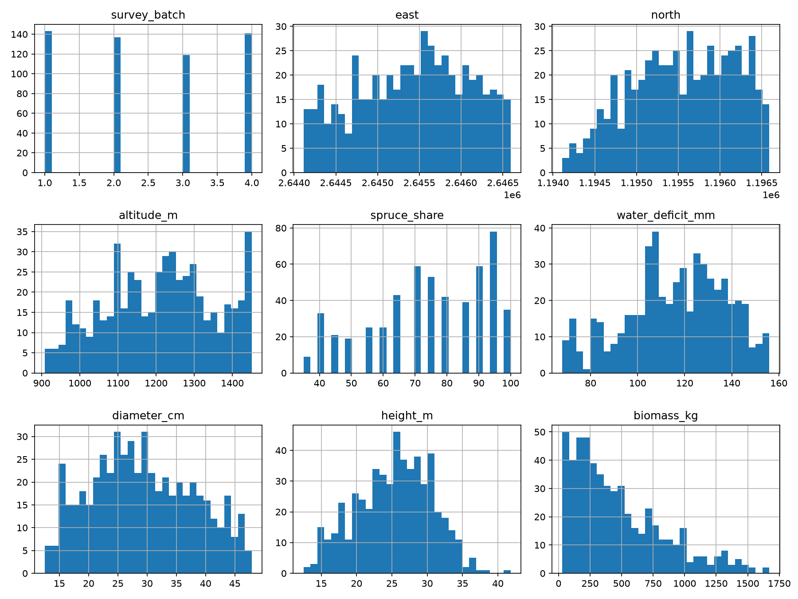
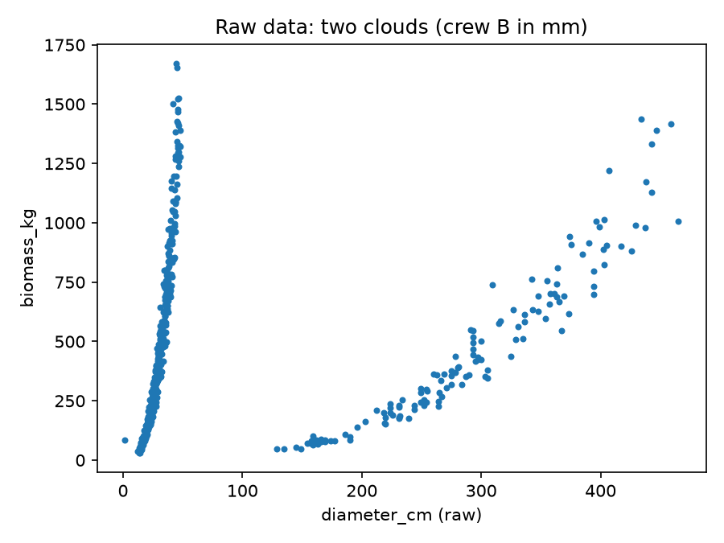
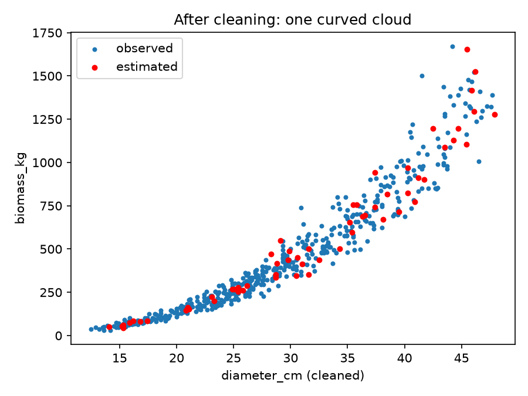
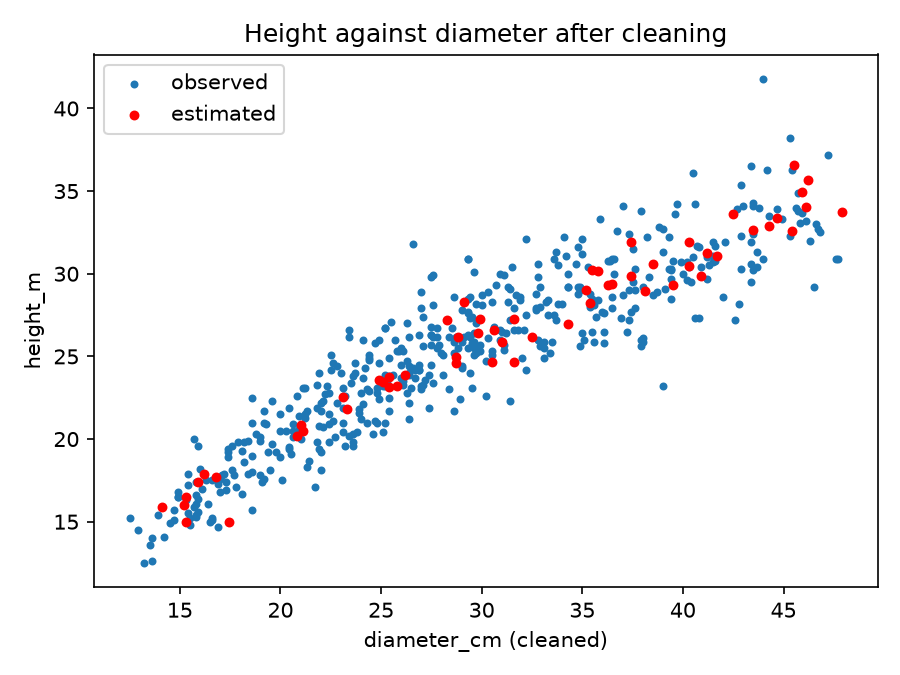

# Report draft: sections 2 and 3, felled trees (Aristides)

Status: draft in Markdown. The report tool is still an open decision (LaTeX is the default in
`CLAUDE.md`, section 7). Caspar's part (inspected and district trees) is added to the same sections later.
Figures are in `code/figures/`.

---

## 2. Exploratory data analysis: felled trees

`train/felled_trees.csv` has 540 trees and 12 columns: the 11 shared columns and `biomass_kg`, the target
of Task 2. The column types are correct. No tree is duplicated, and every `tree_id` has the same format.
Only `height_m` has empty cells (40 trees).

**Categories (after cleaning).** Crew: A 126, B 136, C 147, D 131. Survey batch: 1 (143), 2 (137), 3 (119),
4 (141). Aspect: S 195, E 190, W 105, N 50 (see section 3, problem 5).

**Numeric columns (after cleaning and estimation).**

| Column | Mean | SD | Min | Median | Max |
|---|---|---|---|---|---|
| diameter_cm | 29.3 | 8.7 | 12.5 | 28.8 | 47.9 |
| height_m | 25.4 | 5.3 | 12.5 | 25.8 | 41.8 |
| biomass_kg (observed, raw) | 472.7 | 359.5 | 30.4 | 373.7 | 1671.9 |

Figure 1 shows the histograms of all numeric columns after cleaning. Diameter and height have one
unimodal distribution. Biomass is strongly right-skewed, with most trees below 500 kg and a long tail
up to about 1700 kg. This skew is the reason for using logarithms in the power-law models of Task 2.

*Figure 1. Histograms of the numeric columns of the felled trees after cleaning and estimation (n = 540).
Biomass is right-skewed, which motivates the logarithmic model in Task 2.*

Figure 2 shows biomass against diameter before cleaning. The points form two separate clouds, which is
the first sign of a unit problem.

*Figure 2. Biomass against diameter before cleaning. Two clouds: the right one is crew B, with diameters
about ten times larger.*

---

## 3. Data problems and cleaning: felled trees

We checked every column for values that cannot be true, placeholders, missing values, mixed units,
inconsistent categories, odd coordinates and duplicates. We found five problems. For each one, the evidence
comes from the raw data, and the repair is a rule in the cleaning code, not a manual fix.

1. **Diameters in millimetres for crew B.** Evidence: all 136 diameters above 100 cm belong to crew B, and
   crew B has no diameter below 100 cm. In Figure 2, the right cloud has the same shape as the left one,
   with diameters about ten times larger. Repair: divide crew B's diameters by 10 (`clean_felled`).
   After the repair, diameters range from 12.5 to 47.9 cm, and the two clouds merge into one (Figure 3).

2. **Height 0 as a placeholder.** Evidence: 18 trees have `height_m` = 0, spread over all four crews. A
   tree cannot be 0 m tall. Repair: treat 0 as missing.

3. **Empty heights.** Evidence: 40 trees have an empty `height_m`, spread over all crews. Together with
   problem 2, 58 of 540 heights (11%) are missing. Repair: estimate them (problem 4 describes the method).

4. **Impossible diameter.** Evidence: one tree of crew A (T742819) has a diameter of 1.6 cm, but a height of
   15 m and a biomass of 85.7 kg. Both point to a diameter of about 16 cm, so the value is most likely a
   decimal error. Repair: diameters below 5 cm are treated as missing, and the missing values are estimated
   from the other measurements. No single row is corrected by hand.

   **Estimation method.** Missing diameters and heights are estimated with two linear regressions on the
   logarithms, which is the power-law model of Task 2:
   - diameter model: log(diameter) from log(height) and log(biomass);
   - height model: log(height) from log(diameter) and log(biomass).

   Both models are fitted only on training trees with all three values observed, and the fitted models are
   saved in `code/models/` so that the same models are applied to `test/` without refitting. On the
   training data, R² is about 0.97 for the diameter model and 0.90 for the height model. The estimated
   diameter for T742819 is 17.4 cm, close to the value suggested by the other measurements.

5. **Inconsistent aspect spellings.** Evidence: the direction south appears as `S`, `South`, `s` (with a trailing
   space in the file) and `SÜD` (counts: S 92, South 40, `s ` 36, SÜD 27). Repair: spaces are removed, the text
   is upper-cased, and all spellings are mapped to N, E, S or W (`clean_shared`). This rule is shared by all
   three files.

After the repairs, the data have no missing values, the diameter and height distributions are plausible,
and biomass against diameter forms one curved cloud (Figures 3 and 4). The estimated trees fall on the same
trend as the observed ones, so the estimates do not form a separate group.

*Figure 3. Biomass against diameter after cleaning. Estimated trees (red) lie inside the observed cloud.*

*Figure 4. Height against diameter after cleaning. Estimated heights (red) follow the same trend as the
observed ones.*

**Discussion (Task 1, Aristides).** The most important finding was a unit problem that affected one crew
completely, which only became visible when we compared biomass with diameter. What we are least sure of is
the estimation of the missing values: they rely on a linear model fitted on about 480 trees, and the
single impossible diameter was estimated from only two other measurements.
